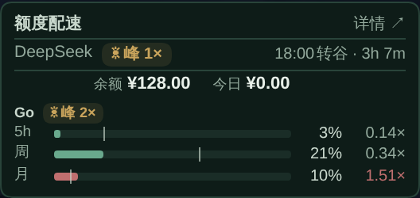
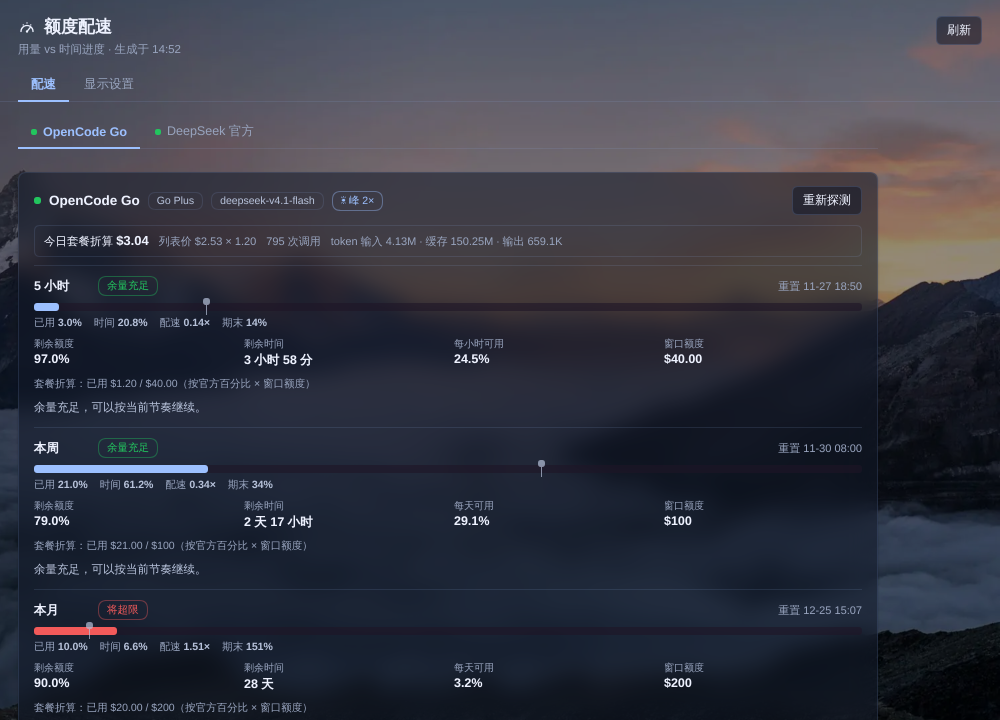

# Quota Pacer · dsh-quota-pacer

English · [中文](README.md)

A DSH plugin that puts OpenCode Go's 5-hour, weekly and monthly quotas next to elapsed time, so you can see whether current usage will hit the limit before the window resets. It supports OpenCode Go and the DeepSeek official API.

Percentages and reset times come from the official usage endpoint; the plugin doesn't re-price tokens. Version 0.1.0, tested on DSH 0.2.2-rc.5.



## Features

- Three windows: 5 hours, this week, this month. Each shows used %, elapsed time %, pace and projected end-of-window usage.
- Pace = used % ÷ elapsed %. Above the threshold it turns red and reports an estimated time to the limit plus a slowdown suggestion.
- A permanent card at the bottom left: DeepSeek peak/off-peak state, balance, today's spend, and three Go progress rows. The white tick marks elapsed time.
- Peak hours: weekdays 09:00–12:00 and 14:00–18:00 Beijing time. Everything else, weekends and Chinese public holidays are off-peak. DeepSeek official is half price off-peak; Go is 2× during peak.
- Four card themes, default Forest. CNY by default; USD and the exchange rate are configurable.
- The pacing view and settings use one sheet per provider.



## Install

Requires DSH 0.2.2-rc.5 or newer.

```bash
git clone https://github.com/huihui308/dsh-quota-pacer.git
```

In DSH Web: Plugins → Add plugin, enter the local absolute path to the repo (or the Git URL), then enable it. Open **Quota Pacer** from the sidebar.

Credentials, either one:

- OpenCode Go: `OPENCODE_GO_API_KEY`, or the local `opencode auth login` session.
- DeepSeek official: `DEEPSEEK_API_KEY`.

The first query sends a 1-token request to read the plan tier and allowance multiplier. Disable **auto probe** in settings if you don't want that request.

## Settings

Each provider has its own sheet:

- OpenCode Go: windows, plan tier, primary model, amount toggle.
- DeepSeek official: local ledger spend, balance.
- Appearance and amounts: card theme, display currency, exchange rate.
- Refresh and alerts: refresh interval, fast/limit thresholds.

Config file: `$DSH_HOME/quota-pacer/config.json`.

## How amounts are counted

OpenCode Go normalizes quota percentages by each model's monthly allowance. DeepSeek V4.1 Flash has a $100 allowance on Go, $200 on Go Plus and $105 on Go Teams.

Go charges `allowance`, not the token list price. On Go Plus, the observed `allowance` was about 1.2× `list_cost`. The plugin shows plan consumption as official percentage × window allowance, and puts the list price on the same today row.

DeepSeek balance comes from the official balance endpoint. Today/month spend comes from the cost-meter ledger. Amounts default to CNY; Go allowances stay in USD.

## Data sources

| Data | Source |
| --- | --- |
| 5h / weekly / monthly percentages and reset times | `https://opencode.ai/zen/go/v1/usage` |
| Model prices, peak multipliers, monthly allowances | `https://opencode.ai/zen/go/v1/models` |
| DeepSeek balance | `https://api.deepseek.com/user/balance` |
| Local spend | `$DSH_HOME/storages/cost-meter/ledger.json` (read-only) |

## Limits

- Official percentages are integers, so amount reconciliation has a ±0.5% granularity.
- Today/month spend depends on the cost-meter ledger. Without it, only official percentages are shown.
- With mixed models, amounts are normalized against the primary model's monthly allowance, not split per model.
- The 5-hour window is treated as the official fixed 5-hour block.
- Public holidays are handled as weekends by default. Add dates under `sources.*.holidays` if needed.

## Development

```bash
npm test
```

- `host.js`: routes, config, data fetching.
- `lib/pacing.js`: pacing math.
- `lib/peak.js`: peak/off-peak schedule.
- `client.js`: panel, sidebar card, settings.

`master` is the stable branch; `develop` is for development.

## License

MIT
