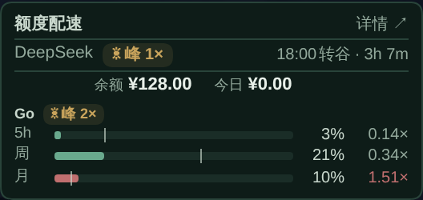
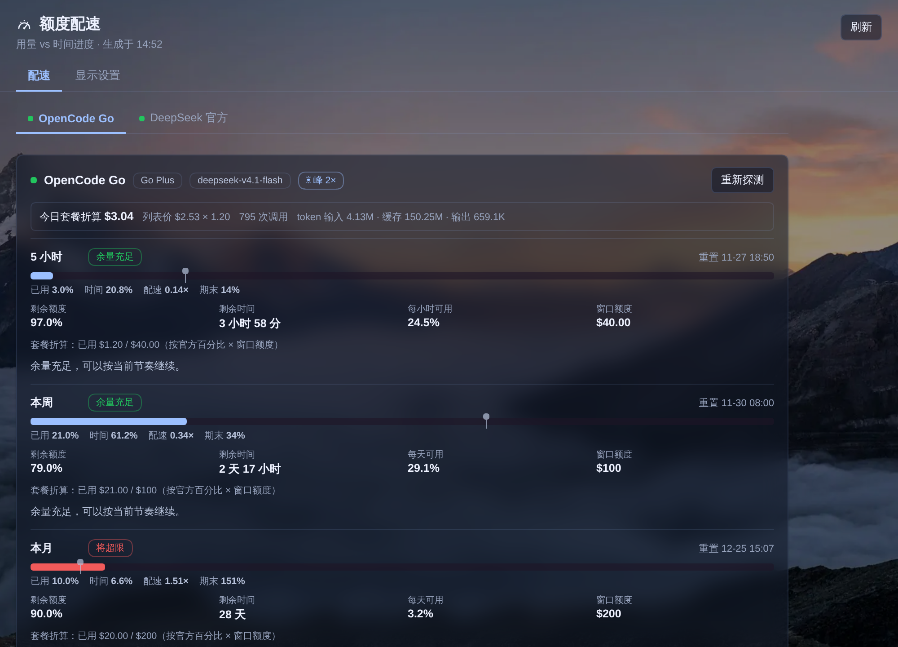

# 额度配速 · dsh-quota-pacer

[English](README.en.md) · 中文

DSH 插件，把 OpenCode Go 的 5 小时、周、月额度和时间进度放在一起，看现在的用法会不会在窗口结束前触顶。目前支持 OpenCode Go 和 DeepSeek 官方两个来源。

百分比和重置时间直接读官方 usage 接口，不在本地重新计价。当前版本 0.1.0，已在 DSH 0.2.2-rc.5 上验证。



## 功能

- 5h / 周 / 月三个窗口：已用百分比、时间百分比、配速、期末预测。
- 配速 = 已用% ÷ 时间%。超过阈值标红，给出预计触顶时间和降速建议。
- 左侧栏底部常驻卡片：DeepSeek 峰谷、余额、今日花费；Go 三行进度条，白线是时间进度。
- 峰谷：工作日 09:00–12:00、14:00–18:00 为峰；其余时段、周末、法定节假日为谷。DeepSeek 官方谷时五折，Go 峰时 2 倍。
- 四套卡片配色，默认墨绿香槟；默认人民币，可切美元并设置汇率。
- 配速页和设置页按 provider 分 sheet，一次只看一个。



## 安装

要求 DSH 0.2.2-rc.5 或更高。

```bash
git clone https://github.com/huihui308/dsh-quota-pacer.git
```

DSH Web → 插件 → 添加插件，填入仓库的本地绝对路径（也可以直接填 Git 地址）。安装后打开侧栏「额度配速」。

凭据二选一：

- OpenCode Go：`OPENCODE_GO_API_KEY`，或本机 `opencode auth login` 的登录态。
- DeepSeek 官方：`DEEPSEEK_API_KEY`。

首次查询会发一个 1-token 请求，读套餐档位和 allowance 倍率。不想自动探测，在设置里关掉「自动探测套餐档位」。

## 配置

设置页按 provider 分开：

- OpenCode Go：窗口、套餐档位、主模型、金额开关。
- DeepSeek 官方：本地账本花费、余额。
- 外观与金额：卡片配色、货币、汇率。
- 刷新与预警：刷新间隔、偏快/超限阈值。

配置文件：`$DSH_HOME/quota-pacer/config.json`。

## 金额口径

OpenCode Go 的额度百分比按每个模型的月度额度归一化。DeepSeek V4.1 Flash 在 Go 是 $100，Go Plus 是 $200，Go Teams 是 $105。

Go 扣的是 `allowance`，不是 token 列表价。实测 Go Plus 的 `allowance` 约为 `list_cost` 的 1.2 倍。插件用官方百分比 × 窗口额度显示套餐折算金额，并在今日一行同时给出列表价。

DeepSeek 的余额来自官方接口，今日/本月花费来自 cost-meter 账本。默认按人民币显示，Go 额度保留美元。

## 数据来源

| 数据 | 来源 |
| --- | --- |
| 5h / 周 / 月百分比与重置时间 | `https://opencode.ai/zen/go/v1/usage` |
| 模型价格、峰谷倍率、套餐月度额度 | `https://opencode.ai/zen/go/v1/models` |
| DeepSeek 余额 | `https://api.deepseek.com/user/balance` |
| 本地花费 | `$DSH_HOME/storages/cost-meter/ledger.json`（只读） |

## 限制

- 官方百分比是整数，金额对账有 ±0.5% 的粒度误差。
- 今日/本月花费依赖 cost-meter 账本；没装或账本重置时只显示官方百分比。
- 多模型混用时，金额按主模型的月度额度折算，不逐模型拆分。
- 5 小时窗口按官方固定 5 小时块计算。
- 法定节假日默认只按周末处理，可在 `sources.*.holidays` 补日期。

## 开发

```bash
npm test
```

- `host.js`：路由、配置、数据抓取。
- `lib/pacing.js`：配速计算。
- `lib/peak.js`：峰谷时段。
- `client.js`：面板、侧栏卡片、设置。

`master` 为稳定分支，`develop` 为开发分支。

## License

MIT
